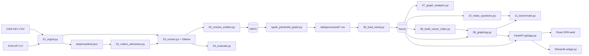

# CVE Knowledge Graph & GraphRAG

A local, resource-conscious vulnerability analytics platform. It turns public CISA KEV, NVD into an explainable **Neo4j knowledge graph**, then compares **Cypher / Graph Data Science analytics**, **vector RAG**, **GraphRAG** and **Text2Cypher** on the *same* graph, with a reproducible benchmark.

Everything runs on a laptop: no paid API, no GPU, open data only. The LLM (Llama 3.2) and the embeddings (`nomic-embed-text`) run locally through [Ollama](https://ollama.com).


> **Read this first.** The project is an engineering and evaluation exercise, not production threat intelligence. The graph is built by LLM extraction, so every `AFFECTS` and `HAS_WEAKNESS` edge is an *inferred* claim (labelled `llm_extraction`), never an independently verified fact. See [Limitations](#limitations).

---

## What it does

1. **Ingests** the most recent CISA KEV entries that NVD has analysed, plus GitHub advisories when they exist.
2. **Extracts** products, vendors, versions and weakness phrases with a local LLM, under a JSON schema, then **grounds** them in the source text.
3. **Resolves** vendor and product names deterministically.
4. **Transforms** the data with Spark over HDFS into nine graph tables.
5. **Loads** them into Neo4j and runs six Cypher and four GDS analyses.
6. **Answers** natural-language questions in two modes: `vector` (nearest advisory texts) and `graph` (exact CVE lookup, entity linking, graph facts, one exploit-chain hop).
7. **Benchmarks** four approaches on 22 generated questions with automatic scoring.
8. **Serves** the result through a FastAPI service and two interfaces (React).

## Architecture



**Graph model**

```text
(Vendor)-[:PRODUCES]->(Product)<-[:AFFECTS]-(CVE)-[:HAS_WEAKNESS]->(Weakness)
(CVE)-[:CHAINED_WITH]-(CVE)        stored once per pair, queried without direction
(CVE)-[:MENTIONS_CWE]->(CWE)
```

CVEs cited in a chain but outside the corpus are kept as stub nodes (`in_corpus = false`). The corpus holds 60 CVEs, hence 61 CVE nodes.

## Repository layout

| Path | Content |
|---|---|
| `pipeline/` | Numbered stages `01_ingest.py` to `11_benchmark.py`, plus `ollama_client.py` |
| `spark_jobs/` | `build_graph.py`: Spark ETL (validation, deduplication, graph tables) |
| `scripts/` | `03_run_etl.ps1` (HDFS + Spark + export), smoke tests, `mock_ollama.py`, `seed_demo_graph.py` |
| `docker/` | `docker-compose.yml` (HDFS, Spark, Neo4j), `hadoop.env` |
| `api/` | `app.py` (FastAPI) and `routing.py` (rule-based question router) |
| `ui/app.py` | Streamlit interface |
| `web/` | React / Vite / TypeScript single-page application |
| `tests/` | API, router and streaming tests (`test_api.py`) |
| `benchmark/` | Questions, cached results, extraction and analytics reports |
| `data/` | `manifest.json`, resolved entities; raw and extracted data are git-ignored |

## Tech stack

| Layer | Technology |
|---|---|
| Language | Python 3.11 |
| LLM and embeddings | Ollama: `llama3.2`, `nomic-embed-text` (CPU) |
| Storage and ETL | HDFS (Hadoop 3.2.1), Apache Spark 3.5.9 (Docker) |
| Graph | Neo4j 5 Community with APOC and Graph Data Science |
| API | FastAPI, Uvicorn, Pydantic |
| Interfaces | React 18 + Vite + TypeScript (2D force graph) |
| Tests | pytest, httpx, Vitest |

Versions come from `requirements.txt`, `web/package.json` and `docker/docker-compose.yml`. Neo4j minor version, plugin versions and Ollama model digests are not pinned.

## Prerequisites

- Windows with PowerShell (the scripts are `.ps1`; commands below are PowerShell).
- Docker Desktop (WSL2), about 6 GB of memory for the stack, plus memory for Ollama.
- [Ollama](https://ollama.com) installed and running locally.
- Python 3.11 and Node.js (for the React app).

## Quick start

### 1. Python environment

```powershell
python -m venv .venv
.\.venv\Scripts\Activate.ps1
python --version
```

`requirements.txt` is encoded in **UTF-16**. Convert it to UTF-8 before installing:

```powershell
python -c "from pathlib import Path; p=Path('requirements.txt'); b=p.read_bytes(); p.write_text(b.decode('utf-16') if b.startswith(b'\xff\xfe') else b.decode('utf-8-sig'),encoding='utf-8')"
python -m pip install -r requirements.txt
python -m pip install -r requirements-dev.txt
```

### 2. Local secret and services

Create the git-ignored file `docker\.env` containing a variable `NEO4J_PASSWORD` with a value of your choice. Never commit it or paste it anywhere. Compose does not read it automatically: pass it explicitly.

```powershell
docker compose --env-file docker\.env -f docker\docker-compose.yml config --quiet
docker compose --env-file docker\.env -f docker\docker-compose.yml up -d
docker compose --env-file docker\.env -f docker\docker-compose.yml ps
```

HDFS needs one to two minutes after a start; `scripts/03_run_etl.ps1` waits for it.

### 3. Models

```powershell
ollama pull llama3.2
ollama pull nomic-embed-text
```

### 4. Build the graph (expensive: network, LLM, HDFS and Neo4j writes)

```powershell
python pipeline\01_ingest.py --count 60 --max-candidates 300
python pipeline\02_collect_advisories.py
python pipeline\03_extract.py --model llama3.2
python pipeline\04_evaluate.py --dir llama3.2
python pipeline\05_resolve_entities.py --dir llama3.2
.\scripts\03_run_etl.ps1 -Dir llama3.2
python pipeline\06_load_neo4j.py
python pipeline\07_graph_analytics.py
python pipeline\08_build_vector_index.py
python pipeline\10_make_questions.py --verify
```

Notes:

- Keep `--max-candidates` explicit: the default (60) is the number of KEV entries examined, not a guarantee of 60 usable CVEs.
- To reproduce existing numbers, **keep the provided `data/manifest.json`** instead of refreshing the catalogue.
- `06_load_neo4j.py --reset` deletes every node. Do not use it on a graph you want to keep.
- `10_make_questions.py --verify` should end with `ALL CONSISTENT`.

### 5. Run the API and an interface

```powershell
$env:API_KEY = "<a-private-demo-key>"
python -m uvicorn api.app:app --host 127.0.0.1 --port 8000
```

In a second terminal:

```powershell
python -m streamlit run ui\app.py
```

Or the React application:

```powershell
Push-Location web
npm ci
npm run dev
Pop-Location
```

Open the address printed by Vite (the API allows `localhost:5173` and `127.0.0.1:5173` by default) and enter the API URL and key in the settings view.

## API

Interactive documentation is served at `/docs`.

| Route | Auth | Description |
|---|---|---|
| `GET /health` | none | `{status: ok\|degraded, neo4j, ollama}` |
| `POST /ask` | `X-API-Key` if `API_KEY` is set | Body `{question, mode}`; `mode` is `auto` (default), `graph` or `vector` |
| `POST /ask/stream` | idem | Same parameters; server-sent events: `route`, `retrieval`, `token`, `result`, `error` |
| `GET /graph` | idem | `{nodes, links}` snapshot for the graph explorer (read-only) |

```powershell
$body = @{ question = "Which CVEs are chained with CVE-2026-105133?"; mode = "graph" } | ConvertTo-Json
Invoke-RestMethod -Uri http://127.0.0.1:8000/ask -Method Post -ContentType "application/json" -Headers @{"X-API-Key" = $env:API_KEY} -Body $body
```

Main response fields: `answer`, `mode`, `sources`, `context_cves`, `retrieval_s`, `generation_s`. Optional fields: `route`, `cypher`, `context`, `ungrounded`, `cached`.

**Routing (`mode = auto`).** Recognised aggregation questions (five Cypher templates in `api/routing.py`) are answered by Cypher directly, without the LLM. A question naming a known CVE id goes through GraphRAG's exact lookup; anything else goes through GraphRAG. This router is **not** an arm of the benchmark.

**Errors** are JSON `{detail}`: `401` bad or missing key, `422` invalid question or mode (empty, over 1,000 characters), `429` rate limit, `503` Neo4j or Ollama unavailable, `500` internal.

**Access control.** If `API_KEY` is set, `/ask`, `/ask/stream` and `/graph` require the `X-API-Key` header (constant-time comparison). Without it the API is open (development mode). `/health` stays public. A key can be tested cheaply: `POST /ask` with an empty question returns `401` for a wrong key and `422` for a valid one, and never calls the LLM.

**Runtime protections:** in-memory answer cache (300 s, 256 entries) and rate limit (60 requests per minute per IP), both per process.

## Configuration

Environment variable names only; never commit values.

| Variable | Purpose |
|---|---|
| `NEO4J_PASSWORD` | Neo4j password (required by Compose and the host scripts, or read from `docker\.env`) |
| `NEO4J_URI`, `NEO4J_USER` | Connection overrides (defaults `bolt://localhost:7687`, `neo4j`) |
| `NVD_API_KEY` | Optional; shortens the delay between NVD requests |
| `GITHUB_TOKEN` | Optional; higher GitHub advisory quota |
| `OLLAMA_URL`, `OLLAMA_MODEL`, `OLLAMA_EMBED_MODEL` | Ollama endpoint and models |
| `EMBED_DOC_PREFIX`, `EMBED_QUERY_PREFIX` | Embedding task prefixes |
| `API_KEY` | Enables access control on the API |
| `API_WARMUP`, `ASK_CACHE_TTL`, `RATE_LIMIT_PER_MIN`, `CORS_ORIGINS`, `OLLAMA_HOST` | API warm-up, cache, rate limit, CORS, health probe |
| `API_URL` | Backend URL used by the Streamlit UI |

Ports: API 8000, Streamlit 8501, Vite 5173, Neo4j 7474 / 7687, HDFS 9870 / 9000, Spark 8080 / 7077 / 8081, Ollama 11434.

## Benchmark

`pipeline/11_benchmark.py` compares four arms on 22 questions (seed 42): **6 factual (A)**, **6 multi-hop (B)**, **6 aggregation (C)** and **4 semantic (D)**.

| Arm | What it is |
|---|---|
| `oracle_cypher` | The hand-written gold query. Correct **by construction**: a ceiling and a latency reference, not a model |
| `vector` | Classic RAG: top-5 CVE texts by embedding similarity |
| `graph` | GraphRAG: exact CVE lookup, entity linking, graph facts, one chain hop |
| `text2cypher` | The LLM writes a read-only Cypher query, executed with a 30 s timeout and one retry |

Scoring is automatic, with no LLM judge: precision, recall and F1 on the entities mentioned in the answer (by name or alias; names of two or three characters are matched case-sensitively), exact match for counts, and source precision against each question's evidence CVEs. Results are cached per `question|arm` with a prompt version.

```powershell
python pipeline\11_benchmark.py --report-only
python pipeline\11_benchmark.py --arms graph vector --types A B
python pipeline\11_benchmark.py --arms text2cypher --force
python pipeline\11_benchmark.py --rescore
```

`--rescore` recomputes scores from cached answers without calling the LLM, but still needs Neo4j. It does not rerun failed queries or add missing versions. A full run takes roughly 1 to 1.5 hours on a CPU laptop: plug in the machine and close other applications.

### Reference results (macro F1, one run per question)

| Question type | n | Vector RAG | GraphRAG |
|---|---:|---:|---:|
| A: factual | 6 | 66.7 % | 97.6 % |
| B: multi-hop | 6 | 36.7 % | 87.6 % |
| C: aggregation | 6 | 0.0 % | 2.2 % |
| D: semantic (silver) | 4 | 23.1 % | 13.3 % |
| **Overall** | 22 | **32.4 %** | **53.5 %** |

GraphRAG also has the better source precision (about 85 % against 70 %). These two columns are identical in every recorded run. **Text2Cypher** and **Oracle** values differ between cached states (Text2Cypher overall F1 between 36.9 % and 50 %; one cached Oracle query failed with an execution error), so quote them only after reconciling the cache (see [Known issues](#known-issues)). In short: graph retrieval clearly helps on exact-identifier and relational questions; aggregations need a structured query.

## Tests

```powershell
python -m pytest tests
Push-Location web
npm test
npm run build
Pop-Location
```

These suites use a stubbed RAG layer and unit tests of the web client. They do **not** prove behaviour against a live Neo4j and Ollama; end-to-end checks are manual (health, 401 with a wrong key, a multi-hop question, Neo4j stop and restart).

### Demo tooling

- The React app has a clearly labelled demo-data source in its settings.
- `scripts/mock_ollama.py` is a canned Ollama-compatible server for UI tests.
- `scripts/seed_demo_graph.py` seeds invented vulnerabilities into Neo4j. It refuses a non-empty database, and its `--force` option **wipes the database**: demo use only.

## Data sources and provenance

| Source | Use | Limits |
|---|---|---|
| CISA KEV | Corpus selection, date added, ransomware flag | CSV download |
| NVD API 2.0 | Descriptions, CPE and CWE (ground truth for extraction evaluation only) | About 6.5 s between requests without a key |
| GitHub Advisory Database | Narrative text when available | 60 requests per hour without a token |

NVD structured fields are **never** given to the extraction model. Each extraction record keeps the source text, raw output, grounded output, regex results, dropped counts, model and prompt version. Raw, extracted and processed data are git-ignored; keep the manifest and caches to reproduce results. No licence audit of the redistributed data has been done.

## Limitations

- **The benchmark gold describes the LLM-built graph**, not the real world. The oracle only proves query/gold consistency.
- **Type D is "silver"**: keyword matching on CVE text.
- **Prompts were tuned after a four-question pilot** that remains in the benchmark (GraphRAG v2, Text2Cypher v2). The comparison is not blind.
- **One run per question and arm**: differences are indicative, not statistical. Latency depends on CPU load; only the ordering of approaches is stable.
- **Small, selected corpus** (60 KEV CVEs, 9 chained pairs): no sector-level conclusions.
- **Grounding checks textual support, not truth**; weakness phrases are not filtered. The extraction prompt keeps a fixed few-shot example whose influence has not been measured.
- **Declared sources are constrained to the retrieved context** (a source cannot be invented) but may still be mis-attributed.
- **Text2Cypher is not formally sandboxed**: a keyword denylist plus read-only access.
- **API protections are per process**; no TLS, identity management or audit log. Keep `API_KEY` set outside local development.

## Known issues

- `requirements.txt` is UTF-16 and looks like a full environment freeze; convert and review it before installing.
- The cached benchmark in `benchmark/results.json` mixes prompt versions and contains records without a version field; `benchmark/results.md` can disagree with it. Reconcile before quoting final numbers:

  ```powershell
  python pipeline\11_benchmark.py --rescore
  python pipeline\11_benchmark.py --arms oracle_cypher --force
  python pipeline\11_benchmark.py --arms graph vector text2cypher
  python pipeline\11_benchmark.py --report-only
  ```

- Docstrings in `pipeline/01_ingest.py` and `pipeline/02_collect_advisories.py` still show old unnumbered script names.
- `LICENSE` still contains a placeholder copyright holder.

## Contributing

Small, feature-sized commits with `feat:`, `fix:` or `docs:` prefixes. Never commit secrets (`docker\.env`, API keys, tokens). Bump the arm version in `pipeline/11_benchmark.py` whenever a prompt or retrieval change affects results, and keep the pilot and single-run disclosures. Report exactly what was tested, distinguishing mocks from live service runs. More detail for assistants: [AGENTS.md](AGENTS.md) and [docs/PROJECT_HANDOFF.md](docs/PROJECT_HANDOFF.md).

## Troubleshooting

| Symptom | Likely cause and fix |
|---|---|
| `No module named 'neo4j'` | Virtual environment not activated: run `.\.venv\Scripts\Activate.ps1` |
| Compose complains about `NEO4J_PASSWORD` | Create `docker\.env` and pass `--env-file docker\.env` |
| HDFS command fails right after start | HDFS safe mode: wait; the ETL script polls and waits |
| Container name collision | Inspect `docker compose ps` and remove only obsolete containers of this project |
| Ollama 404 | Model not pulled: run the two `ollama pull` commands |
| API `401` | Key missing or different from the server's `API_KEY` |
| API `503` | Neo4j or Ollama is down: check `GET /health` |
| GitHub advisories stop after about 60 requests | Anonymous quota; results are cached, rerun later |
| `pip install -r requirements.txt` shows NUL characters | UTF-16 file: convert it first (see Quick start) |

## Licence

MIT, see [LICENSE](LICENSE). The licence covers this repository's code; data from CISA, NVD and GitHub and the Ollama models keep their own terms.