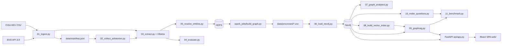

# CVE Knowledge Graph & GraphRAG

[](https://www.python.org/)
[](https://neo4j.com/)
[](https://fastapi.tiangolo.com/)
[](https://react.dev/)
[](LICENSE)

## Executive Summary

A local vulnerability analytics platform that builds an explainable knowledge graph from public CVE data and compares GraphRAG with classic vector RAG and Text2Cypher. Its benchmark shows where graph context helps most—multi-hop questions—and where structured Cypher queries are better suited to aggregations.

## Architecture



**Graph model**

```text
(Vendor)-[:PRODUCES]->(Product)<-[:AFFECTS]-(CVE)-[:HAS_WEAKNESS]->(Weakness)
(CVE)-[:CHAINED_WITH]-(CVE)        stored once per pair, queried without direction
(CVE)-[:MENTIONS_CWE]->(CWE)
```

CVEs referenced in an exploit chain but absent from the source corpus are represented as stub nodes (`in_corpus = false`). The reference corpus contains 60 CVEs and the graph has 61 CVE nodes.

**Repository map**

| Path | Responsibility |
|---|---|
| `pipeline/` | Numbered ingestion, extraction, graph loading, GraphRAG, and benchmark stages |
| `spark_jobs/` | Spark transformations that validate and export graph tables |
| `docker/` | Docker Compose services for HDFS, Spark, and Neo4j |
| `api/` | FastAPI application and question router |
| `web/` | The project's React, Vite, and TypeScript interface |
| `tests/` | API, router, and streaming tests |
| `benchmark/` | Questions, benchmark results, and evaluation reports |
| `data/` | Manifest and processed data; raw and extracted data are git-ignored |

## Tech Stack

| Layer | Technology |
|---|---|
| Language | Python 3.11 |
| Containers and storage | Docker Compose, HDFS (Hadoop 3.2.1) |
| Distributed processing | Apache Spark 3.5.9 |
| Knowledge graph | Neo4j 5 Community, APOC, Graph Data Science |
| LLM and embeddings | Ollama, Llama 3.2, `nomic-embed-text` |
| API | FastAPI, Uvicorn, Pydantic |
| Frontend | React 18, Vite, TypeScript |
| Testing | pytest + httpx (19 automated backend tests); Vitest for the frontend |

## Key Features

1. Ingests CISA KEV entries and their NVD records, with GitHub advisories where available.
2. Uses a local LLM and a JSON schema to extract vendors, products, versions, and weakness phrases, then grounds extracted data in source text.
3. Resolves vendor and product names deterministically.
4. Transforms source data with Spark over HDFS into graph-ready tables.
5. Loads the data into Neo4j and runs Cypher and Graph Data Science analyses.
6. Answers natural-language questions with classic vector RAG or GraphRAG, including exact CVE lookup and graph relationships.
7. Benchmarks four approaches—Oracle Cypher, vector RAG, GraphRAG, and Text2Cypher—on 22 questions with automatic scoring.
8. Exposes the platform through a FastAPI backend and a single React web interface.

## Benchmark Results

Macro F1 scores from the recorded 22-question benchmark:

| Question type | Questions | Vector RAG | GraphRAG | Text2Cypher | Oracle Cypher |
|---|---:|---:|---:|---:|---:|
| Factual (1 hop) | 6 | 67% | 98% | 83% | 100% |
| **Multi-hop** | **6** | 37% | **88%** | 50% | 100% |
| **Aggregation** | **6** | 0% | 2% | **17%** | 100% |
| Semantic (silver gold) | 4 | 23% | 13% | 49% | 100% |
| **Overall** | **22** | **32%** | **54%** | **50%** | **100%** |

**Takeaway:** GraphRAG leads on multi-hop questions; Text2Cypher scores higher than GraphRAG on aggregations, although both remain far below the exact Cypher oracle. The oracle is a hand-written reference query, not a generative approach. GraphRAG also recorded higher source precision than vector RAG (85% vs. 70%).

These are indicative results, not statistically established findings: each question and approach was run once, and prompts were tuned after a four-question pilot. The benchmark cache contains mixed prompt versions; rescore and reconcile it before treating the figures as final.

## Quick Start

The commands below are for Windows PowerShell. Prerequisites: Python 3.11, Docker Desktop with WSL2, Node.js, and [Ollama](https://ollama.com). Allow approximately 6 GB of memory for the Docker stack, in addition to Ollama's requirements. Run commands from the repository root.

### 1. Create and activate the Python environment

```powershell
python -m venv .venv
.\.venv\Scripts\Activate.ps1
python --version
```

`requirements.txt` is currently encoded in UTF-16. Convert it to UTF-8 before installing the project dependencies:

```powershell
python -c "from pathlib import Path; p=Path('requirements.txt'); b=p.read_bytes(); p.write_text(b.decode('utf-16') if b.startswith(b'\xff\xfe') else b.decode('utf-8-sig'),encoding='utf-8')"
python -m pip install -r requirements.txt
```

### 2. Start Docker Compose services

Create `docker\.env` with a private Neo4j password. This file must not be committed or shared.

```powershell
Set-Content -Path docker\.env -Value 'NEO4J_PASSWORD=replace-with-a-private-password'
docker compose --env-file docker\.env -f docker\docker-compose.yml config --quiet
docker compose --env-file docker\.env -f docker\docker-compose.yml up -d
docker compose --env-file docker\.env -f docker\docker-compose.yml ps
```

HDFS can take one to two minutes to become ready.

### 3. Download the local Ollama models

Ensure Ollama is running, then pull the LLM and embedding model:

```powershell
ollama pull llama3.2
ollama pull nomic-embed-text
```

### 4. Build the graph

This end-to-end step downloads data, runs local LLM extraction, and writes to HDFS and Neo4j. To reproduce the recorded benchmark, keep the provided `data/manifest.json`.

```powershell
python pipeline\01_ingest.py --count 60 --max-candidates 300
python pipeline\02_collect_advisories.py
python pipeline\03_extract.py --model llama3.2
python pipeline\04_evaluate.py --dir llama3.2
python pipeline\05_resolve_entities.py --dir llama3.2
.\scripts\03_run_etl.ps1 -Dir llama3.2
python pipeline\06_load_neo4j.py
python pipeline\07_graph_analytics.py
python pipeline\08_build_vector_index.py
python pipeline\10_make_questions.py --verify
```

The verification command should finish with `ALL CONSISTENT`. Avoid `python pipeline\06_load_neo4j.py --reset` unless you intend to delete every node in the Neo4j database.

### 5. Run the API

Set a private API key before starting the service. In a PowerShell terminal:

```powershell
$env:API_KEY = "<your-private-api-key>"
python -m uvicorn api.app:app --host 127.0.0.1 --port 8000
```

### 6. Run the React interface

In a second terminal, start the Vite development server:

```powershell
Push-Location web
npm ci
npm run dev
Pop-Location
```

Open the URL printed by Vite (normally `http://localhost:5173`) and configure the API URL and API key in the interface settings. The API allows the local Vite origins by default.

## API Endpoints

Interactive API documentation is available at `http://127.0.0.1:8000/docs`.

| Method and route | Authentication | Description |
|---|---|---|
| `GET /health` | None | Reports API, Neo4j, and Ollama health (`ok` or `degraded`). |
| `POST /ask` | `X-API-Key` when `API_KEY` is configured | Answers a question. Request body: `{"question": "...", "mode": "auto"}`; modes are `auto`, `graph`, and `vector`. |
| `POST /ask/stream` | `X-API-Key` when `API_KEY` is configured | Streams an answer as server-sent events. |
| `GET /graph` | `X-API-Key` when `API_KEY` is configured | Returns a read-only `{nodes, links}` graph snapshot for the explorer. |

`auto` routes recognized aggregation questions to parameterized Cypher, named CVE lookups to graph retrieval, and other questions to hybrid retrieval. Without `API_KEY`, protected endpoints are open; set it outside local development.

## Testing

Run the 19 automated backend tests (pytest and httpx) from the repository root:

```powershell
python -m pytest tests
```

To run the React test suite and verify its production build:

```powershell
Push-Location web
npm test
npm run build
Pop-Location
```

The backend tests use stubs and do not prove behavior against live Neo4j or Ollama services. Live integration checks should be run separately.


## Credits

- **Data sources:** CISA KEV, NVD, and GitHub Advisory Database.
- **Open-source components:** the tools and models listed in [Tech Stack](#tech-stack) retain their respective licenses and terms.

